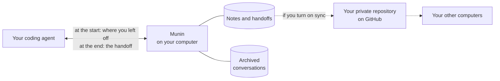
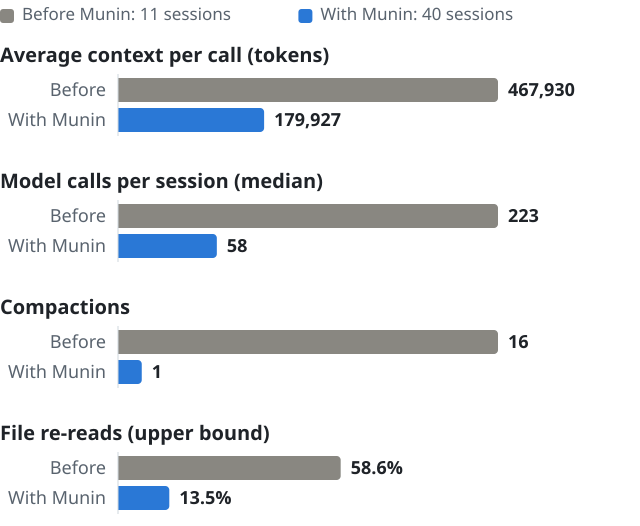
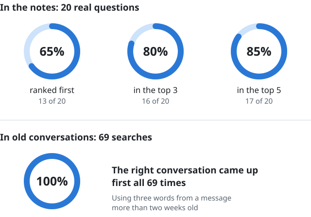
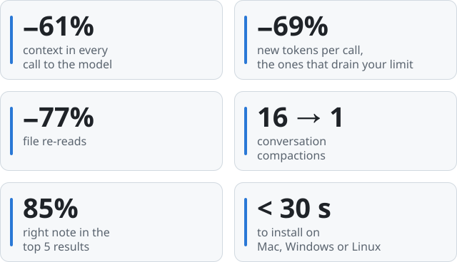

<a href="README.md">Español</a> · <b>English</b>

  <picture>
    <source media="(prefers-color-scheme: dark)" srcset="imagenes/munin-oscuro.png">
    
  </picture>

<h3 align="center">Memory for your coding agents</h3>

  <a href="https://munin.iarg.dev/solicitar?idioma=en">
    <picture>
      <source media="(prefers-color-scheme: dark)" srcset="imagenes/solicitar-oscuro-en.svg">
      
    </picture>
  </a>

## What it is

Munin is a memory for your AI coding agents: it keeps your decisions, the state of each project and what you talked about with them. When you open a new conversation, your agent knows where you left off without you having to explain it, even if you were working with a different agent or on a different computer. That way you can work in short conversations, which cost less and forget less, instead of stretching one out until the agent gets lost.

## How it works

- Munin runs on your computer and connects to your agent through MCP, the standard agents use to work with tools.
- When a conversation starts, it gives your agent a short summary of where you left off.
- When you finish, or when the conversation gets long and Munin warns you, your agent saves a handoff: the goal, what was done and what comes next. The new conversation picks up from there.
- Your agent can search your notes and your old conversations, by words and by meaning.
- Each project has its own memory, and nothing from one gets mixed into another.
- Before saving anything, it masks the passwords and keys it recognizes.

## Results

### Two weeks of real use

Measured on my own conversations with Claude Code: 11 before Munin (up to November 4, 2026) and 40 with Munin (November 6 to 17).

<picture>
  <source media="(prefers-color-scheme: dark)" srcset="imagenes/uso-real-oscuro-en.svg">
  
</picture>

- **Context per call:** at every step, the agent sends the whole conversation to the model again. It drops 61%: less spending and fewer slip-ups.
- **Calls per session:** conversations are shorter, because each one picks up where the previous one left off.
- **Compactions:** when the conversation fills up, the agent summarizes it and loses details. It happened 16 times before and once with Munin.
- **Re-reads:** files the agent reads again in the same conversation. It is an upper bound, because some re-reads are needed.

### Finding what you saved

When your agent searches the memory, does it get the right thing? I measured it in two ways: with 20 real questions about my notes, and by searching for 69 of my own messages, all more than two weeks old, using three of their words.

<picture>
  <source media="(prefers-color-scheme: dark)" srcset="imagenes/busqueda-oscuro-en.svg">
  
</picture>

Munin searches by words and also by meaning, with a small model that runs on your computer. That way it finds the note even if you don't use the same words it was saved with. Both tests were run in Spanish, the language of my notes.

### Installation

A single line in the terminal installs everything, including its own Node 24, without administrator permissions and without touching any other Node you already have. It takes up about 700 MB. You install your agents yourself: Munin connects the ones it finds.

| System | Time | Where it was tested |
|---|---|---|
| macOS | under 30 s | Someone else's Mac, from scratch |
| Windows | under 30 s | Someone else's PC, from scratch |
| Linux | 8 s | Ubuntu 24.04, from scratch |

### In short

<picture>
  <source media="(prefers-color-scheme: dark)" srcset="imagenes/resumen-oscuro-en.svg">
  
</picture>

## What it works with

| Agent | What Munin connects when you install it |
|---|---|
| Claude Code | Tools, memory at startup and a handoff before the conversation gets summarized |
| Codex | Tools, memory at startup and a handoff before the conversation gets summarized |
| Antigravity | Tools and memory at startup |
| GitHub Copilot (VS Code and CLI) | Tools and memory at startup |
| Cursor | Tools; at the start, ask it to check Munin |

Any other agent that supports MCP can use its tools if you connect it by hand.

It works on **macOS, Windows and Linux**. If you turn on sync, you have the same memory on all your computers.

Munin speaks English and Spanish: it is installed in the language of the form, and `munin idioma` changes it later. The command names are in Spanish (`munin actualizar`, `munin comandos`...), but everything they show is in English.

## Privacy

- **Your memory is yours.** It lives on your computer, and there is no Munin server that stores it.
- **If you use it on several computers,** it travels through a private repository in your own GitHub account, with a key you create yourself that only works for that repository. Archived conversations never leave your computer.
- **The author of Munin cannot see your memory,** your keys or your repository. It is not a promise: the design does not allow it.
- **The only thing the author sees** is the name on your invitation and the names you give your devices. Choose ones that don't say who you are.
- **No telemetry.** Munin only connects to the internet to sync, if you turn it on, and to update itself when you ask it to.
- What your agent reads from the memory is sent to its model, like the rest of the conversation.

## Request access

Munin is installed with a personal invitation.

1. Fill in the form with your name, your email and your system. The button below opens it in English, and Munin will be installed in English.
2. When I approve your request, you will get an email with your link, which only works once.
3. Open the link and follow the [installation guide](#installation-guide): a single line in the terminal installs everything.

The form data is only used to reply to you. It is deleted when the request is approved or rejected, or otherwise after 30 days.

  <a href="https://munin.iarg.dev/solicitar?idioma=en">
    <picture>
      <source media="(prefers-color-scheme: dark)" srcset="imagenes/solicitar-oscuro-en.svg">
      
    </picture>
  </a>

## Installation guide

**Before you start:** you need at least one AI coding agent installed. Munin installs everything else.

1. **Open the link in the email** and press **Continue**. The invitation is used up as soon as you open it and the page cannot be opened again, so do the next step right away.
2. **Choose your system and copy the line** with the **Copy** button. That line works for a single installation.
3. **Paste it into the terminal and press Enter:**
   - **macOS:** open Terminal, which is in Applications › Utilities.
   - **Windows:** open PowerShell; search for it in the Start menu.
   - **Linux:** open a terminal and paste with Ctrl+Shift+V. It needs `curl`: if you don't have it, on Ubuntu you can install it with `sudo apt install curl`.
4. **Wait a few seconds.** Munin downloads what it needs and connects the agents it finds.
5. **If it asks whether you want your memory on all your devices,** answer `y` or `n`. For yes you need a GitHub account: Munin opens pre-filled pages for you to create your private repository and a key that only works for it. You can also turn it on later with `munin sincronizar`.
6. **Close your agent and open it again.** If it asks for permission to use Munin's tools, always allow them. If the terminal told you about another step for your agent, do it.
7. **Open a new conversation and work as usual.** When you finish, ask your agent to save a handoff: the next conversation will know where you left off.

### Afterwards

| Command | What it does |
|---|---|
| `munin actualizar` | Installs the latest version of Munin |
| `munin dispositivos nuevo <name>` | Installs Munin on another computer of yours, without another invitation |
| `munin user` | Opens your Munin page, with your devices |
| `munin idioma es` | Switches Munin to Spanish; `munin idioma en` switches it back |
| `munin desinstalar` | Disconnects Munin from your agents; your memory stays |
| `munin comandos` | All the commands |

---

  

