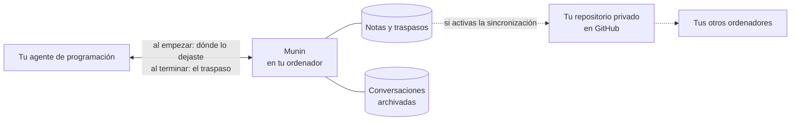
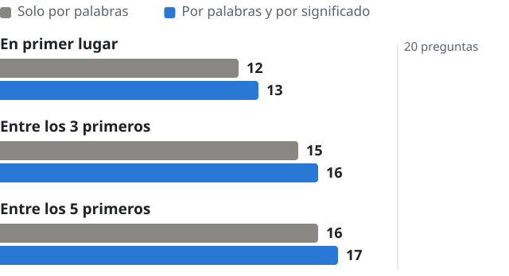

  <picture>
    <source media="(prefers-color-scheme: dark)" srcset="imagenes/munin-oscuro.png">
    
  </picture>

<h3 align="center">La memoria de tus agentes de programación</h3>

  <a href="https://munin.iarg.dev/solicitar">
    <picture>
      <source media="(prefers-color-scheme: dark)" srcset="imagenes/solicitar-oscuro.svg">
      
    </picture>
  </a>

## Qué es

Munin es una memoria para tus agentes de programación con IA: guarda las decisiones, el estado de cada proyecto y lo que hablaste con ellos. Cuando abres una conversación nueva, tu agente sabe por dónde ibais sin que se lo expliques, aunque la empezaras con otro agente o en otro ordenador. Así puedes trabajar en conversaciones cortas, que gastan menos y olvidan menos, en vez de alargar una hasta que el agente se pierde.

## Cómo funciona

- Munin funciona en tu ordenador y se conecta a tu agente con MCP, el estándar con el que los agentes usan herramientas.
- Al empezar una conversación, le da a tu agente un resumen corto de dónde lo dejaste.
- Cuando terminas, o cuando la conversación se alarga y Munin avisa, tu agente guarda un traspaso: el objetivo, lo hecho y lo siguiente. La conversación nueva sigue desde ahí.
- Tu agente puede buscar en las notas y en las conversaciones antiguas, por palabras y por significado.
- Cada proyecto tiene su propia memoria, y lo de uno no se mezcla con otro.
- Antes de guardar nada, tapa las contraseñas y claves que reconoce.

## Resultados

### Dos semanas de uso real

Medido en mis propias conversaciones con Claude Code: 11 antes de Munin (hasta el 4 de noviembre de 2026) y 40 con Munin (del 6 al 17 de noviembre).

<picture>
  <source media="(prefers-color-scheme: dark)" srcset="imagenes/uso-real-oscuro.svg">
  
</picture>

- **Contexto por llamada:** en cada paso, el agente reenvía al modelo toda la conversación. Baja un 61 %: menos gasto y menos despistes.
- **Llamadas por sesión:** las conversaciones son más cortas, porque cada una sigue donde lo dejó la anterior.
- **Compactaciones:** cuando la conversación se llena, el agente la resume y pierde detalles. Pasó 16 veces antes y 1 con Munin.
- **Relecturas:** ficheros que el agente vuelve a leer en la misma conversación. Es una cota máxima, porque algunas relecturas hacen falta.

> [!NOTE]
> Con sinceridad: el trabajo no fue el mismo. Antes eran conversaciones largas de otros proyectos; con Munin, 28 de las 40 fueron del propio Munin. Por eso se compara lo que cuesta cada llamada, no cada tarea. Además, casi todo el contexto se lee de la caché, que cuenta menos en el límite de uso, así que el ahorro en tu límite es menor que el porcentaje.

### Encontrar lo que guardaste

Munin busca por palabras y también por significado, con un modelo pequeño que funciona en tu ordenador. Lo probé con 20 preguntas reales sobre mis notas: ¿sale la nota correcta entre los primeros resultados?

<picture>
  <source media="(prefers-color-scheme: dark)" srcset="imagenes/busqueda-oscuro.svg">
  
</picture>

Mejoran 4 preguntas y no empeora ninguna. La mejora es pequeña, y 20 preguntas son pocas.

### Instalación

Una sola línea en la terminal lo instala todo, incluido su propio Node 24, sin permisos de administrador y sin tocar otro Node que ya tengas. Ocupa unos 700 MB. Tus agentes los instalas tú: Munin conecta los que encuentre.

| Sistema | Tiempo | Dónde se probó |
|---|---|---|
| macOS | menos de 30 s | Un Mac de otra persona, desde cero |
| Windows | menos de 30 s | Un PC de otra persona, desde cero |
| Linux | 8 s y 12 s | Ubuntu 24.04, en arm64 y en x64 |

## Con qué funciona

| Agente | Qué conecta Munin al instalarlo |
|---|---|
| Claude Code | Herramientas, memoria al empezar y traspaso antes de que resuma la conversación |
| Codex | Herramientas, memoria al empezar y traspaso antes de que resuma la conversación |
| Antigravity | Herramientas y memoria al empezar |
| GitHub Copilot (VS Code y CLI) | Herramientas y memoria al empezar |
| Cursor | Solo las herramientas |

Cualquier otro agente que admita MCP puede usar sus herramientas, conectándolo a mano.

Funciona en **macOS, Windows y Linux**. Si activas la sincronización, tienes la misma memoria en todos tus ordenadores. Munin y sus mensajes están en español.

## Privacidad

- **Tu memoria es tuya.** Vive en tu ordenador, y no hay ningún servidor de Munin que la guarde.
- **Si la usas en varios ordenadores,** viaja por un repositorio privado de tu propia cuenta de GitHub, con una clave que creas tú y que solo sirve para ese repositorio. Las conversaciones archivadas no salen nunca de tu ordenador.
- **El autor de Munin no puede ver tu memoria,** ni tus claves ni tu repositorio. No es una promesa: el diseño no lo permite.
- **Sin telemetría.** Munin solo se conecta a internet para sincronizar, si lo activas, y para actualizarse cuando tú se lo pides.
- Lo que tu agente lee de la memoria se envía a su modelo, como el resto de la conversación.

## Pedir acceso

Munin se instala con una invitación personal.

1. Rellena el formulario con tu nombre, tu correo y tu sistema.
2. Cuando apruebe la solicitud, te llegará un correo con tu enlace, que solo sirve una vez.
3. Abre el enlace y sigue los pasos: una línea en la terminal lo instala todo.

Los datos del formulario solo sirven para responderte. Se borran al aprobar o rechazar la solicitud y, si no, a los 30 días.

  <a href="https://munin.iarg.dev/solicitar">
    <picture>
      <source media="(prefers-color-scheme: dark)" srcset="imagenes/solicitar-oscuro.svg">
      
    </picture>
  </a>

---

  

