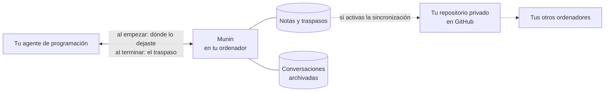
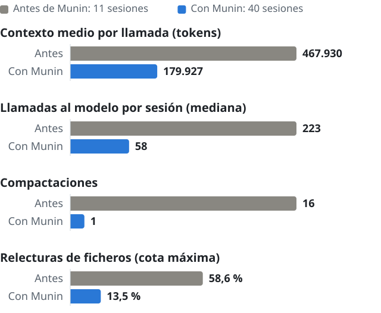
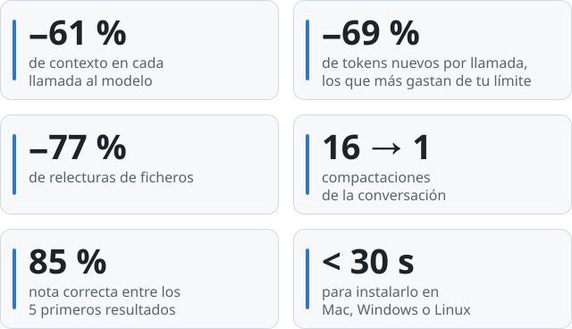

<b>Español</b> · <a href="README.en.md">English</a>

  <picture>
    <source media="(prefers-color-scheme: dark)" srcset="imagenes/munin-oscuro.png">
    
  </picture>

<h3 align="center">La memoria de tus agentes de programación</h3>

  <a href="https://munin.iarg.dev/solicitar">
    <picture>
      <source media="(prefers-color-scheme: dark)" srcset="imagenes/solicitar-oscuro.svg">
      
    </picture>
  </a>

## Qué es

Munin es una memoria para tus agentes de programación con IA: guarda las decisiones, el estado de cada proyecto y lo que hablaste con ellos. Cuando abres una conversación nueva, tu agente sabe por dónde ibais sin que se lo expliques, aunque la empezaras con otro agente o en otro ordenador. Así puedes trabajar en conversaciones cortas, que gastan menos y olvidan menos, en vez de alargar una hasta que el agente se pierde.

## Cómo funciona

- Munin funciona en tu ordenador y se conecta a tu agente con MCP, el estándar con el que los agentes usan herramientas.
- Al empezar una conversación, le da a tu agente un resumen corto de dónde lo dejaste.
- Cuando terminas, o cuando la conversación se alarga y Munin avisa, tu agente guarda un traspaso: el objetivo, lo hecho y lo siguiente. La conversación nueva sigue desde ahí.
- Tu agente puede buscar en las notas y en las conversaciones antiguas, por palabras y por significado.
- Cada proyecto tiene su propia memoria, y lo de uno no se mezcla con otro.
- Antes de guardar nada, tapa las contraseñas y claves que reconoce.

## Resultados

### Dos semanas de uso real

Medido en mis propias conversaciones con Claude Code: 11 antes de Munin (hasta el 4 de noviembre de 2026) y 40 con Munin (del 6 al 17 de noviembre).

<picture>
  <source media="(prefers-color-scheme: dark)" srcset="imagenes/uso-real-oscuro.svg">
  
</picture>

- **Contexto por llamada:** en cada paso, el agente reenvía al modelo toda la conversación. Baja un 61 %: menos gasto y menos despistes.
- **Llamadas por sesión:** las conversaciones son más cortas, porque cada una sigue donde lo dejó la anterior.
- **Compactaciones:** cuando la conversación se llena, el agente la resume y pierde detalles. Pasó 16 veces antes y 1 con Munin.
- **Relecturas:** ficheros que el agente vuelve a leer en la misma conversación. Es una cota máxima, porque algunas relecturas hacen falta.

### Encontrar lo que guardaste

Cuando tu agente busca algo en la memoria, ¿le sale lo correcto? Lo medí de dos formas: con 20 preguntas reales sobre mis notas, y buscando 69 mensajes míos de hace más de dos semanas con tres de sus palabras.

<picture>
  <source media="(prefers-color-scheme: dark)" srcset="imagenes/busqueda-oscuro.svg">
  
</picture>

Munin busca por palabras y también por significado, con un modelo pequeño que funciona en tu ordenador. Así encuentra la nota aunque no uses las mismas palabras con las que se guardó.

### Instalación

Una sola línea en la terminal lo instala todo, incluido su propio Node 24, sin permisos de administrador y sin tocar otro Node que ya tengas. Ocupa unos 700 MB. Tus agentes los instalas tú: Munin conecta los que encuentre.

| Sistema | Tiempo | Dónde se probó |
|---|---|---|
| macOS | menos de 30 s | Un Mac de otra persona, desde cero |
| Windows | menos de 30 s | Un PC de otra persona, desde cero |
| Linux | 8 s | Ubuntu 24.04, desde cero |

### En resumen

<picture>
  <source media="(prefers-color-scheme: dark)" srcset="imagenes/resumen-oscuro.svg">
  
</picture>

## Con qué funciona

| Agente | Qué conecta Munin al instalarlo |
|---|---|
| Claude Code | Herramientas, memoria al empezar y traspaso antes de que resuma la conversación |
| Codex | Herramientas, memoria al empezar y traspaso antes de que resuma la conversación |
| Antigravity | Herramientas y memoria al empezar |
| GitHub Copilot (VS Code y CLI) | Herramientas y memoria al empezar |
| Cursor | Herramientas; al empezar, pídele que mire en Munin |

Cualquier otro agente que admita MCP puede usar sus herramientas, conectándolo a mano.

Funciona en **macOS, Windows y Linux**. Si activas la sincronización, tienes la misma memoria en todos tus ordenadores.

Munin habla español e inglés: se instala en el idioma del formulario, y `munin idioma` lo cambia después.

## Privacidad

- **Tu memoria es tuya.** Vive en tu ordenador, y no hay ningún servidor de Munin que la guarde.
- **Si la usas en varios ordenadores,** viaja por un repositorio privado de tu propia cuenta de GitHub, con una clave que creas tú y que solo sirve para ese repositorio. Las conversaciones archivadas no salen nunca de tu ordenador.
- **El autor de Munin no puede ver tu memoria,** ni tus claves ni tu repositorio. No es una promesa: el diseño no lo permite.
- **Lo único que ve el autor** es el nombre de tu invitación y los nombres que pongas a tus dispositivos. Elige unos que no digan quién eres.
- **Sin telemetría.** Munin solo se conecta a internet para sincronizar, si lo activas, y para actualizarse cuando tú se lo pides.
- Lo que tu agente lee de la memoria se envía a su modelo, como el resto de la conversación.

## Pedir acceso

Munin se instala con una invitación personal.

1. Rellena el formulario con tu nombre, tu correo y tu sistema. Munin se instalará en el idioma del formulario.
2. Cuando apruebe la solicitud, te llegará un correo con tu enlace, que solo sirve una vez.
3. Abre el enlace y sigue el [manual de instalación](#manual-de-instalación): una línea en la terminal lo instala todo.

Los datos del formulario solo sirven para responderte. Se borran al aprobar o rechazar la solicitud y, si no, a los 30 días.

  <a href="https://munin.iarg.dev/solicitar">
    <picture>
      <source media="(prefers-color-scheme: dark)" srcset="imagenes/solicitar-oscuro.svg">
      
    </picture>
  </a>

## Manual de instalación

**Antes de empezar:** necesitas tener instalado al menos un agente de programación con IA. Munin instala todo lo demás.

1. **Abre el enlace del correo** y pulsa **Continuar**. La invitación se gasta al abrirla y la página no se podrá volver a abrir, así que haz el paso siguiente en ese momento.
2. **Elige tu sistema y copia la línea** con el botón **Copiar**. Esa línea sirve para una sola instalación.
3. **Pégala en la terminal y pulsa Intro:**
   - **macOS:** abre Terminal, que está en Aplicaciones › Utilidades.
   - **Windows:** abre PowerShell; búscalo en el menú Inicio.
   - **Linux:** abre una terminal y pega con Ctrl+Mayús+V. Necesita `curl`: si no lo tienes, en Ubuntu se instala con `sudo apt install curl`.
4. **Espera unos segundos.** Munin descarga lo que necesita y conecta los agentes que encuentre.
5. **Si te pregunta si quieres tu memoria en todos tus dispositivos,** responde `s` o `n`. Para el sí necesitas una cuenta de GitHub: Munin te abre las páginas ya rellenas para crear tu repositorio privado y una clave que solo sirve para él. También puedes activarlo más tarde con `munin sincronizar`.
6. **Cierra y vuelve a abrir tu agente.** Si te pide permiso para usar las herramientas de Munin, permítelas siempre. Si la terminal te indicó algún paso más para tu agente, hazlo.
7. **Abre una conversación nueva y trabaja como siempre.** Al terminar, pídele a tu agente que guarde un traspaso: la conversación siguiente sabrá por dónde ibais.

### Después

| Comando | Qué hace |
|---|---|
| `munin actualizar` | Instala la última versión de Munin |
| `munin dispositivos nuevo <nombre>` | Instala Munin en otro ordenador tuyo, sin otra invitación |
| `munin user` | Abre tu página de Munin, con tus dispositivos |
| `munin idioma en` | Pasa Munin al inglés; `munin idioma es` lo devuelve al español |
| `munin desinstalar` | Desconecta Munin de tus agentes; tu memoria se queda |
| `munin comandos` | Todos los comandos |

---

  

